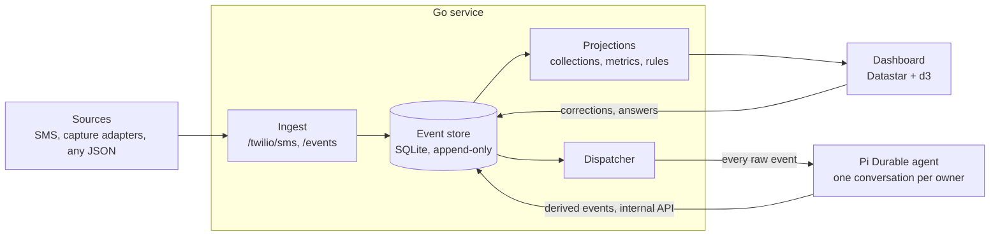

# Lifestream: an always-on agent for your data

As of 2026-10-19. "Lifestream" is a placeholder name.

## Summary

**Send it anything; the agent files it.** Every event you feed the system
(a text, a JSON blob, a turn of a coding session) lands in an append-only
event store. An always-on [Pi Durable](https://earendil.com/posts/pi-durable/)
agent receives every one of them and decides what it is: a reading to
extract, something to file into a collection, a question for the owner, or
just a record to keep for later. Storing is the default and costs nothing:
the raw event is already safe before the agent sees it.

**Data handler first.** The agent's job is turning events into structured,
queryable data. It doesn't sell, publish or send anything. Anything built
on top (monetization included) comes later, as separate, explicit features
that read the derived data. They don't get added to the agent. An earlier,
monetization-first version of this doc is in git history; see
[PRUNED.md](PRUNED.md).

## Origin

It started with a chore: typing the date and my weight into a spreadsheet
every morning, then adding a weekly-average cell every Friday. The fix was to
text `weight 175` to a Twilio number and let an agent file it, with a live
dashboard instead of the spreadsheet.

A text message is just one event from one source. Once there is an
append-only event store with an agent reading it, weight readings, coding
sessions and arbitrary JSON are all the same kind of thing.

## The event stream

Every event shares one envelope and carries a free-form JSON payload. Raw
events from the outside world are never changed. Everything the agent
produces (labels, metric readings, questions) is a **derived event** that
points back to its parent, so any view can be rebuilt and traced back to its
source.

| Field | Meaning |
| --- | --- |
| `id` | ULID: unique and sortable by time |
| `owner` | The user the event belongs to |
| `source` | Where it came from: `twilio.sms`, `cli`, `claude-code`, ... |
| `type` | What it is: `message.received`, `metric.observed`, `llm.message` |
| `occurred_at` / `received_at` | When it happened and when we got it |
| `parent_id` | Set on derived events; null on raw ones |
| `payload` | Arbitrary JSON, as large as the source sends |
| `hash` | SHA-256 over the envelope, chained to the previous event's hash |

New sources don't need schema changes. A source only has to produce the
envelope (`POST /events`, or `lifestream push` reading JSON on stdin).
Teaching the agent what a new `type` means is a prompt or extension change,
not a migration.

### Capture from harnesses

Coding-agent sessions are one stream worth capturing. Thin adapters turn a
harness's hooks into `llm.message` events, one per message, tool call or
result, as they happen:

- **Transcript tailers** (Claude Code, Codex): an end-of-turn hook runs
  `lifestream capture <harness>`, which sends new transcript lines from the
  last saved offset. The transcript file is the offline buffer.
- **In-process extensions** (pi, Strands): send each message directly and
  keep failed sends in memory for the next turn.
- **Retries are safe:** the idempotency key is `(session_id, sequence)`.
- **Store what the harness wrote:** payloads are the harness's own JSON.
  A common format across harnesses is a derived view, rebuildable.
- **Label the session once:** only a session's first few events reach the
  agent; later ones join its collections by a projection rule, with no
  model call.
- **Off by default:** nothing is captured until `LIFESTREAM_CAPTURE=on`;
  `LIFESTREAM_DENY` path globs always win. A deterministic secret scanner
  masks keys and tokens before anything leaves the machine.

## Collections and steering

A **collection** is a named set of events, defined by plain-English rules the
agent applies to each incoming event. A metric (weight) is a collection
whose members also have a number extracted, and it gets a chart.

The owner steers collections while the system runs. Every steering command is
itself an event, sent by text or from the dashboard:

| Owner says | Event | Effect on the definition |
| --- | --- | --- |
| "track my weight" | `collection.started` | New collection with one include rule; status `open` |
| "also include pgbouncer stuff in the migration" | `collection.amended {include}` | Adds an include rule |
| "don't include CI logs in that" | `collection.amended {exclude}` | Adds an exclude rule |
| "stop tracking the migration" | `collection.stopped` | Status `closed`; no new labels |
| "resume the migration one" | `collection.resumed` | Status `open` again |

- **Steering changes data, not code.** Definitions live in Go; a prompt
  section fetches the open ones before every model call, so the very next
  event is judged under the new rules.
- **Every label records the rule version it was made under**, so any
  membership can be explained. The owner's fixes become `label.corrected`
  events that go back to the agent.
- **Starting a collection or adding an include looks back** over the last 7
  days (configurable) in a background task; an exclude re-checks members.
- **Every rule change is in a rule log with one-click undo.**

## The agent

Pi Durable is a harness, not an app: it's the building block for an
always-on agent that survives crashes. Work is checkpointed (including tool
calls in flight) in SQLite, and a restarted process resumes where it left
off without anyone typing "continue". We write the gateway and the
application around it.

- **One long-lived conversation per owner.** Every event is submitted into
  it with the event id as `requestId`, so a redelivered event is never
  processed twice. Owner commands use `whenBusy: "steer"`.
- **Writes go only through Go's internal API**, keyed by the Pi Durable task
  id, so a tool replayed after a crash writes nothing twice. The agent never
  opens Go's database, and Pi Durable can be replaced without losing data.
- **What the owner teaches lives in Go, not the conversation.** "w means
  weight" becomes a rules-doc entry, so background tasks see it too.
- **Large events go in as pointers;** the agent reads what it needs with
  `read_event`.
- **The agent never replies by text.** Questions go to a review queue on the
  dashboard; the owner's answer is submitted back as a new event.

| Extension | Handles | Tools |
| --- | --- | --- |
| `collections` | Steering commands, labeling, extracting metric values, look-back | `create_collection`, `amend_collection`, `stop_collection`, `resume_collection`, `label_event`, `log_value`, `flag_for_review`, `read_event` |
| `rules` | Every event: the owner's standing instructions in the prompt | `add_rule` |

## Architecture

One pod: the Go service, the agent and a Litestream sidecar on a shared
volume. One replica, since SQLite has one writer.

## Risks and open questions

| Risk | Cheapest test |
| --- | --- |
| A model call per event is too expensive at volume | Run it on my own events for two weeks and read the bill; try a small or local model through pi-ai |
| The agent files things wrong and nobody notices | The inbox shows what every event became; count corrections per week |
| Pi Durable is experimental (released 2026-10-01) | Pin it exactly; the event store is ours, so the agent can be swapped |

- [ ] Which model? Haiku is the default; a local model may be enough for
      filing.
- [ ] Login (needed before the dashboard faces the internet).
- [ ] The name.

## Phasing

1. **Personal tracker.** SMS and `/events` into the store, the agent
   filing every event, metrics on a live dashboard.
   - *Gate:* two weeks of daily use; I stop using the spreadsheet.
2. **My sessions, filed.** Capture adapters on for my own harnesses; the
   agent files sessions into collections I steer.
   - *Gate:* a month of sessions I can find and replay.
3. **Built on top, explicitly.** Whatever the data turns out to be good for
   (sharing, selling, analysis) is designed then, as features that read
   the derived data. See [PRUNED.md](PRUNED.md) for earlier attempts.

## Sources

- [Pi Durable](https://earendil.com/posts/pi-durable/), Earendil, Oct 2026
- [Pi Durable explained](https://youtu.be/ti3vVYwzW4A), Hugging Face,
  2026-10-19: harness vs. app, conversations as sessions, storage options
