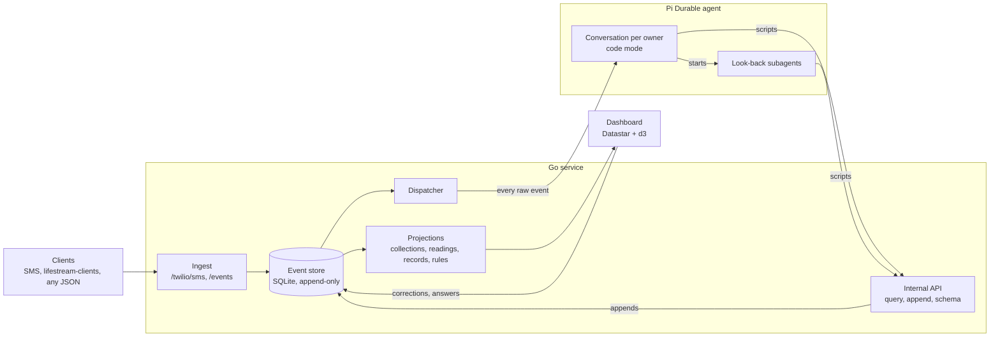

# Lifestream: an event stream with a durable steward

As of 2026-10-20. "Lifestream" is a placeholder name.

## Summary

**Send it anything; a steward makes it data.** Every event you feed the
system (a text, a JSON blob, a turn of a coding session) lands in an
append-only event store. An always-on agent built on
[Pi Durable](https://earendil.com/posts/pi-durable/) receives every one of
them and decides what it becomes: a reading in a metric, a member of a
collection, a record of whatever shape fits, a correction to earlier data,
a question for the owner, or nothing beyond being stored. Storing is the
default and costs nothing: the raw event is already safe before the agent
sees it.

**The agent writes code, not tool calls.** It isn't handed a fixed menu of
operations. It writes JavaScript that queries the whole store with
read-only SQL and appends events, so "re-date last week's readings" or
"start tracking sleep and file everything from the past week" is one
script, and new kinds of data need no new code.

**Data handler first.** The agent turns events into structured, queryable
data. It doesn't sell, publish or send anything. Anything built on top
(monetization included) comes later, as separate, explicit features that
read the derived data. An earlier, monetization-first version of this doc
is in git history; see [PRUNED.md](PRUNED.md).

## Why an event stream into a durable harness

The interesting part is the pairing: an append-only log as the ground
truth, and a durable agent as its steward.

- **The log is the source of truth; the agent never edits it.** Raw events
  are never changed. Everything the agent does is a new derived event
  pointing at the event that caused it, and every view (collections,
  readings, records) is a projection rebuilt from the log. So the agent
  can be given real power: its worst mistake is wrong events, which are
  undone with more events, never lost data.
- **The harness makes the agent a process, not a chat.** Pi Durable
  checkpoints the conversation, every tool call and every script in SQLite.
  A crash mid-script resumes where it stopped, without anyone typing
  "continue" and without repeating a write. Each event is submitted with
  its id as the request id, so redelivery is a no-op.
- **Both sides are idempotent, so they compose.** The dispatcher retries
  until the agent acknowledges; the agent's writes carry the durable task
  id as their idempotency key, so a replayed write is stored once.
- **Either side can be replaced.** The data is Go's. Swap the model, the
  prompt, or Pi Durable itself, and rebuild the views from the log.
- **History is reprocessable.** A new collection, a new rule, or a better
  model can be pointed back at old events (the look-back), because the
  events are all still there.

## Origin

It started with a chore: typing the date and my weight into a spreadsheet
every morning, then adding a weekly-average cell every Friday. The fix was to
text `weight 175` to a Twilio number and let an agent file it, with a live
dashboard instead of the spreadsheet. It has done that since 2026-10-20.

A text message is just one event from one source. Once there is an
append-only event store with an agent reading it, weight readings, workouts,
coding sessions and arbitrary JSON are all the same kind of thing.

## The event stream

Every event shares one envelope and carries a free-form JSON payload.

| Field | Meaning |
| --- | --- |
| `id` | ULID: unique and sortable by time |
| `owner` | The user the event belongs to |
| `source` | Where it came from: `twilio.sms`, `cli`, `dashboard`, `agent`, ... |
| `type` | What it is: `message.received`, `metric.observed`, `record.saved` |
| `occurred_at` / `received_at` | When it happened and when we got it |
| `parent_id` | Set on derived events: what caused them |
| `idempotency_key` | Optional; the server stores one event per owner and key |
| `payload` | Arbitrary JSON |
| `hash` | SHA-256 over the envelope, chained to the previous event's hash |

New sources don't need schema changes. Teaching the agent what a new `type`
means is a prompt change or a rule, not a migration.

### Clients

The server's contract is `POST /events` with a user token. Who pushes
events, and at what granularity, is the client's business: the server
knows nothing about any particular client. First-class clients (capture
adapters for Claude Code, pi, Codex and Strands, with a secret scanner that
masks keys before anything leaves the machine) live in their own repo,
`lifestream-clients`. A client picks its granularity (one event per
coding-session turn, not per message, so a session costs a few agent calls)
and its own idempotency keys, so a resend is a no-op.

## What the agent makes

- **Collections** are named sets of events, defined by plain-English
  include and exclude rules. A **metric** collection also holds numbers
  (readings, each with the time it was observed) and gets a chart.
- **Records** are anything else worth keeping, in whatever shape fits: a
  kind the agent chooses (`workout`, `meal`) and a JSON object. The agent
  reuses the kinds and fields already in use, and when a collection comes
  to cover something it kept as records, it moves the data.
- **Rules** are the owner's standing instructions ("w means weight", "I'm
  on Pacific time"), written down so every future request and every
  background job follows them.
- **Questions** go to a review queue on the dashboard when the agent can't
  tell what was meant; the answer comes back as an event. The agent
  withdraws a question that later events settle.

Readings and records can be dated by what the owner says ("176 yesterday"),
corrected ("the 176 was 177") and withdrawn, all as new events.

### Steering

The owner steers collections while the system runs. Every steering command
is itself an event, sent by text or from the dashboard:

| Owner says | Event | Effect on the definition |
| --- | --- | --- |
| "track my weight" | `collection.started` | New collection with one include rule; status `open` |
| "also include pgbouncer stuff in the migration" | `collection.amended {include}` | Adds an include rule |
| "don't include CI logs in that" | `collection.amended {exclude}` | Adds an exclude rule |
| "stop tracking the migration" | `collection.stopped` | Status `closed`; no new labels |
| "resume the migration one" | `collection.resumed` | Status `open` again |

- **Every label records the rule version it was made under**, so any
  membership can be explained. The owner's fixes on the dashboard become
  `label.corrected` events that go back to the agent.
- **Every rule change is in a rule log with one-click undo.**

## The agent

Pi Durable is a harness, not an app: the building block for an always-on
agent that survives crashes. We write the application around it.

- **One long-lived conversation per owner.** Every raw event is submitted
  into it with the event id as `requestId`. Owner messages steer a busy
  conversation; other sources queue.
- **One tool: code mode.** The model writes JavaScript that runs in a
  QuickJS sandbox (no network, no files), durable across restarts. Scripts
  call two functions, and nothing else can touch data:

  | Function | Does |
  | --- | --- |
  | `query({sql, params})` | One read-only SQL statement over the whole store (a `mode=ro`, `query_only` SQLite connection) |
  | `append({type, parent_id, payload})` | Append one event of a type Go accepts; Go validates it against current state and refuses contradictions |

- **The prompt can't drift from the code.** Before every request, sections
  fetched from Go give the model the database schema (the real `CREATE`
  statements), every event type it may append with its payload shape
  (reflected from the Go structs), the open collections and the owner's
  rules. Each section only changes when its data does, so the prompt cache
  holds.
- **Look-backs are background subagents.** Starting a collection or adding
  a rule creates a background task that owns a child conversation: a copy
  of the steward, given the job as one message ("file everything from the
  last 7 days that belongs"). It files old events exactly as new ones are
  filed, doesn't block the owner's next text, survives restarts, and
  reports a one-line summary back.
- **The model is Claude Sonnet 5.5.** In testing it handled timezones,
  several readings in one text, invented sensible record shapes, and
  corrected readings by id, for about a cent per text.
- **The agent never replies by text.** Its replies are one-line summaries
  nobody reads; its work is what it writes.

## Architecture

One pod: the Go service, the agent and a Litestream sidecar on a shared
volume, backing both SQLite files up to R2. One replica, since SQLite has
one writer.

## Risks and open questions

| Risk | Cheapest test |
| --- | --- |
| A model call per event is too expensive at volume | Read the bill after two weeks of texts; clients send coarse events; a smaller model for routine events |
| The agent files things wrong and nobody notices | The inbox shows what every event became; count corrections per week |
| The agent's freedom produces inconsistent data (two kinds for one thing) | The prompt says reuse kinds; query `records` by kind every week; it can migrate its own data with events |
| Pi Durable is experimental (released 2026-10-01) | Pin it exactly; the event store is ours, so the agent can be swapped |

- [ ] Login for the dashboard (basic auth stands in).
- [ ] `query` reads every owner's rows; fine for one user, revisit before a
      second.
- [ ] Live view of what the agent is doing (Pi Durable's watch API).
- [ ] The name.

## Phasing

1. **Personal tracker.** SMS and `/events` into the store, the steward
   filing every event, readings on a live dashboard.
   - *Gate:* two weeks of daily use; I stop using the spreadsheet.
2. **Other streams.** First-class clients push coding sessions and other
   feeds; the steward files them into collections and records I steer.
   - *Gate:* a month of sessions I can find and query.
3. **Built on top, explicitly.** Whatever the data turns out to be good for
   (sharing, selling, analysis) is designed then, as features that read
   the derived data. See [PRUNED.md](PRUNED.md) for earlier attempts.

## Sources

- [Pi Durable](https://earendil.com/posts/pi-durable/), Earendil, Oct 2026;
  the `@earendil-works/pi-durable` README (code mode, subagents, tasks)
- [Pi Durable explained](https://youtu.be/ti3vVYwzW4A), Hugging Face,
  2026-10-19: harness vs. app, conversations as sessions, storage options
