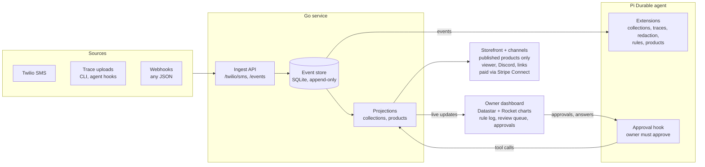

# Lifestream: Patreon for data

As of 2026-10-17. "Lifestream" is a placeholder name.

## Summary

**Patreon for data.** Practitioners sell subscriptions to the byproducts of
their work: pi sessions and other LLM traces, access to a Discord, documents,
private videos, anything. Buyers pay for access to the *person* (what's new,
being close to them, convenience), not for files that could be copied.

"Patreon for data" is the public, brand-friendly pitch. The model we're
actually inspired by is OnlyFans: paying for closeness to a specific person
and for what they make next. Use the Patreon line in anything public.

**The content makes itself.** Patreon, Gumroad and Whop already sell
subscriptions and Discord access. What none of them do is produce the content.
Here, everything the creator does lands in a personal event store. They tell
their agent "start capturing for X" and keep working, and a Pi Durable agent
labels, redacts and bundles the matching events into products. The paywall is
deliberately thin: Stripe, plus adapters that grant and revoke access on each
channel.

**Honor system first.** Most channels start as "here's the link." Channels
that can revoke access (Discord roles, GitHub collaborators, Drive sharing,
the hosted viewer) get real enforcement through adapters over time. Preventing
piracy is not a goal. Revocable access and traceable leaks are.

The weight log that started this is one event type in the store, and the
first thing built on it; it is not the product.

**The product is the platform.** People of note sell subscriptions to the
streams of data they choose to share. We ship them clients that make
uploading easy, which is why the event store exists. Everything else serves
making it easy for them to market and sell those streams.

## Origin

It started with a chore: typing the date and my weight into a spreadsheet
every morning, then adding a weekly-average cell every Friday. The fix was to
text `weight 175` to a Twilio number and let an agent file it, with a live
dashboard instead of the spreadsheet.

Designing that fix changed the frame. A text message is just one event from
one source. Once there is an append-only event store with an agent reading
it, weight readings, coding sessions and arbitrary JSON are all the same kind
of thing. The agent's behavior per event type is swappable at runtime, which
is what Pi Durable's extensions are built for. Selling part of the stream
follows from that: if the store holds data other people value, the owner
should be able to offer it.

## The event stream

Every event shares one envelope and carries a free-form JSON payload. Raw
events from the outside world are never changed. Everything the agent
produces (classifications, metric entries, redacted copies) is a **derived
event** that points back to its parent, so any view can be rebuilt and traced
back to its source.

| Field | Meaning |
| --- | --- |
| `id` | ULID: unique and sortable by time |
| `owner` | The user the event belongs to |
| `source` | Where it came from: `twilio.sms`, `cli`, `webhook.<name>` |
| `type` | What it is: `message.received`, `metric.observed`, `llm.trace` |
| `occurred_at` / `received_at` | When it happened and when we got it |
| `parent_id` | Set on derived events; null on raw ones |
| `payload` | Arbitrary JSON, as large as the source sends |
| `hash` | SHA-256 of the payload, chained to the previous event's hash |

| Event type | Example source | Example payload |
| --- | --- | --- |
| `message.received` | Twilio SMS webhook | `{"from":"+1555…","body":"weight 175"}` |
| `metric.observed` | Derived by the agent | `{"metric":"weight","value":175,"unit":"lb"}` |
| `llm.message` | Harness adapter (pi, Claude Code, Strands), as it happens | One message, tool call or result, with `session_id` and sequence number |
| `llm.trace` | CLI upload, OpenTelemetry export | A whole session at once, from sources without a streaming adapter |
| `note` | SMS, CLI | Free text |
| Any other type | Generic webhook, `lifestream push` reading JSON on stdin | Whatever the source sends |

New sources do not need schema changes. A source only has to produce the
envelope. Teaching the agent what a new `type` means is an extension install,
not a deploy.

### Capture from harnesses

This is what makes the content make itself. There is one ingest endpoint
(`POST /events`, per-user token) and `lifestream push`, which reads JSON on
stdin. Each harness gets a thin adapter that turns its lifecycle hooks into
events, with `source` set to the harness (`pi`, `claude-code`, `strands`).
Adding a harness is a new adapter, never a server change.

- **It's a stream; live isn't special.** Adapters push each message, tool
  call and result as an `llm.message` event as it happens, with a
  `session_id` and a sequence number. A session is just the events that
  share a `session_id`; there's no upload step at the end. Whether a
  product is sold live or edited first is a product choice, not a capture
  one. Sellers will usually collect and edit sessions before selling.
- **Why stream when nothing is sold live:** an upload at session end
  depends on the session ending cleanly. A killed terminal or a sleeping
  laptop may never fire the end hook, and the session is lost. Pushing at
  each turn has no special end step to fail, and a "start capturing for X"
  said mid-session applies to the session in progress. Granularity is per
  turn and tool call, not per token.
- **Label the session once.** Sending every message to the agent would cost
  a model call each. Instead the agent labels a session from its first
  events, and later events with the same `session_id` join the same
  collections automatically (a projection rule, no model call), unless an
  exclude rule removes them. Redaction still runs on each event as it's
  labeled.
- **Retries are safe.** An event's idempotency key is
  `(session_id, sequence)`, so an adapter can buffer while offline and
  resend without duplicates.
- **Store what the harness wrote.** Each event's payload is the harness's
  own message JSON, unchanged. Adapters don't translate formats, so they
  stay thin and nothing is lost. A common format across harnesses (for the
  replay viewer, for buyers) is a derived view built later, and can be
  rebuilt when it changes.
- **Two kinds of adapter.**
  - *Transcript tailers* for harnesses that write a transcript file and can
    run a command when a turn ends: Claude Code and Codex. The hook runs
    `lifestream capture <harness>` with the hook's JSON on stdin; it reads
    the transcript from the last saved offset, sends the new lines (the
    line number is the sequence), and only then moves the offset forward.
    The transcript file is the offline buffer: if the server is down, the
    next turn sends everything since the last success. One Go command
    serves every tailer; each harness only adds a line parser.
  - *In-process extensions* for harnesses with an extension API: pi
    (a TypeScript extension using `pi.on("turn_end", …)`, which gives the
    turn's message and tool results) and Strands (a Python `HookProvider`
    on `MessageAddedEvent`). They POST directly and keep failed sends in
    memory to retry on the next turn. If pi also writes its sessions to a
    file, the extension can call the tailer instead (to check).
- **Harness details (as of 2026-10-17).**
  - Claude Code: every hook gets `session_id`, `transcript_path` and `cwd`
    on stdin. Tail on `Stop` (each turn) and `SessionEnd`. Ship it as a
    Claude Code plugin so installing is one step.
  - Codex: hooks live in `~/.codex/hooks.json` and are off by default
    (enabled in `~/.codex/config.toml`). It can also run a notify program
    at the end of each turn. Sessions are JSONL rollout files under
    `~/.codex/sessions/YYYY/MM/DD/`, possibly zstd-compressed (to check;
    if they are, re-read the file and skip lines already sent).
  - pi: extensions load from `~/.pi/agent/extensions/`. The npm scope moved
    from `@mariozechner/*` to `@earendil-works/*`, so older tutorials are
    out of date.
- **Each event also records where it came from:** the harness, the model,
  `cwd`, and the git remote, branch and commit if `cwd` is a repo.
- **Capture is off by default; users turn it on.** Installing an adapter
  captures nothing until `LIFESTREAM_CAPTURE=on` is set. Setting it in a
  project's `mise.toml` `[env]` turns capture on for that project only;
  setting it in the shell profile turns it on everywhere. `LIFESTREAM_DENY`
  (path globs, e.g. the work checkout) is an optional guard that wins even
  when capture is on. Anything not captured never leaves the machine, which
  is stronger than the `rules` extension blocking it from sale.
  Configuration is environment variables only: `LIFESTREAM_URL`,
  `LIFESTREAM_TOKEN`, `LIFESTREAM_CAPTURE`, `LIFESTREAM_DENY`.
- **Optional secret scan in the adapter.** Running the deterministic scanner
  before upload keeps API keys off the server entirely.
- **Seller edits are derived copies.** Tweaking a session before selling
  produces a derived, edited copy that points back to the raw upload, like
  a redaction. The raw upload is never changed.

## Collections and steering

A **collection** is the building block for everything that gets bundled or
charted. It is a named set of events, defined by rules written in plain
English that the agent applies to each incoming event. A metric like weight
is a collection whose members also have a number extracted from them, and it
gets a chart instead of a price.

The owner steers collections while the system runs. Every steering command is
itself an event, sent by text or from the dashboard, and each one changes the
collection's definition:

| Owner says | Event | Effect on the definition |
| --- | --- | --- |
| "start capturing for the Postgres migration" | `collection.started` | New collection with one include rule; status `open` |
| "also include pgbouncer stuff in the migration topic" | `collection.amended {include}` | Adds an include rule |
| "don't include CI logs in that" | `collection.amended {exclude}` | Adds an exclude rule |
| "stop capturing for the migration" | `collection.stopped` | Status `closed`; no new labels |
| "resume the migration one" | `collection.resumed` | Status `open` again |

**Steering changes data, not code.** The current definition is the result of
applying these events in order, and each change bumps a version number. Go
stores the definitions. One of the agent's system-prompt sections fetches the
open collections from Go. Pi Durable rebuilds sections before every model
call, so the very next event is judged under the new rules, with no restart
and no redeploy. Commands are submitted with `whenBusy: "steer"`, so they
take effect even if the agent is in the middle of other work.

**Every label records the rule version it was made under:**
`label.applied {event_id, collection_id, definition_version, reason}`. Any
membership can be explained ("why is this in here?"). When a rule changes,
it's clear which labels were made under the old version. The owner's manual
fixes become `label.corrected` events that go back to the agent, so it learns
where the boundary is.

**Starting a collection or adding an include looks back.** The agent
labels new events from then on, and also reviews its own recent past events
over a look-back window. The window defaults to 7 days and can be set in the
command ("start capturing for the migration, look back 30 days") or as a
per-user setting. Look-backs run as a background Pi Durable task that saves
its progress as it goes, so a crash or restart doesn't lose the scan:

- after `collection.started` or an include, it checks events in the window
  that aren't already members
- after an exclude, it re-checks current members

Each event checked costs one model call, so the window is also a cost limit.

An exclude removes a member only if it hasn't been sold. Anything already in
a sold snapshot stays in it, because buyers paid for it.

Every rule change appears in a rule log on the dashboard with an undo button.
A misread "stop capturing" should take one click to fix.

## Products and channels

A **product** is a collection the owner has approved for sale. Publishing
creates one Stripe Product, on the owner's Stripe Connect account, with up to
two kinds of Price:

- **One-time:** a snapshot of the collection at a cutoff ("my 6-week Postgres
  migration, complete"). This fits closed collections.
- **Recurring:** a subscription to new approved members as they arrive. This
  fits open collections.

Products live under the creator's namespace: `<creator>/<namespace>/<product>`,
for example `alice/pg-migration/book` and `alice/pg-migration/env`. The
platform doesn't link products to each other; grouping them under a
namespace is how a creator presents related ones together.

The platform takes its cut as an application fee on each sale. Stripe also
handles seller identity checks, payouts and tax forms. Go handles Stripe's
webhooks and the agent never touches payments.

Buyers pay for **who** made the content and **how** they work, not for
volume. A respected engineer's 30 real sessions on a hard migration are worth
more than a million anonymous chat logs. Public examples of expert LLM use
are curated: a clean prompt in a blog post, a screenshot on social media. The
real thing (the false starts, the corrections, how context gets set up, when
they give up on the model) is what people want to learn from. It is never
published because cleaning it up is tedious and there's no reward for doing
it.

**A channel delivers access to a product.** Each channel is an adapter with
two operations: `Grant(buyer, product)` on payment and `Revoke(buyer,
product)` on cancellation or refund. On an honor-system channel, `Revoke`
does nothing.

| Channel | Grant / revoke | Enforced? |
| --- | --- | --- |
| Hosted viewer (pi session replay, static artifacts) | Our own login | Yes |
| claude.ai artifact link | Share the link | Honor system (unless claude.ai can share to specific people) |
| Discord | Bot adds or removes a role | Yes |
| GitHub private repo | Add or remove collaborator | Yes |
| Google Drive / Docs | Share to or unshare from the buyer's email | Yes |
| File download (JSONL, media) | Expiring signed URLs | Mostly |
| Rex environment (see below) | Share or unshare the buyer's own environment on the tailnet | Yes |
| YouTube unlisted, any other link | Send the link | Honor system |

Start with the hosted viewer plus honor-system links. Add enforced channels
when sellers ask for them. Per-buyer watermarking makes leaks traceable on
any channel.

### Environments as products (rex)

Idea from 2026-10-16. The flagship product could be **access to a rex
session**: a fully set-up environment a buyer drops into and explores, like
loading a Halo map. Instead of reading a replay of my Postgres migration, the
buyer gets a shell where the repo is checked out, the database is loaded, the
pi sessions are on disk, and the tools are installed. Scarcity is part of the
offer, since not everyone gets in.

This fits the collection model. A snapshot product already defines a cutoff
and a set of members, and an environment is one more way to deliver it: the
collection's redacted contents, built into a box. The hosted replay viewer
shows what happened; the environment lets the buyer poke at it.

What rex does today, from its docs (as of 2026-10-16):

- One `rex` binary is both the server and the CLI. It installs from a
  .deb/.rpm package, a Nix flake, or as a single binary. **The Linux server
  can't be installed yet, even by beta testers,** but it's being built fast
  and expected soon. Building around it now is a deliberate bet: be ready
  when it lands.
- Server modes: *personal* (runs as your own account, no root; any `rex`
  command starts one), *shared* (one server under a `rex` account, "for a few
  people you trust"), and *login* (one server per user, each running as their
  own account).
- The server listens only locally by default. There is no real auth yet
  (SSH keys are planned). The recommended path is Tailscale:
  `rex server start --tailscale` joins the tailnet itself, and Tailscale tells
  rex who is connecting. Plain HTTP needs `--allow-anonymous`, which the docs
  call "super dangerous."
- Clients connect with the Mac app ("Add Remote Host…" with an address like
  `https://build.<tailnet>.ts.net`) or the CLI (`rex -S build ls`). Hosts
  added with `rex hosts` stay in the CLI and don't show up in the app.

What that implies for the design:

- **Tailscale is the access channel.** `Grant` shares the buyer's node to
  their tailnet and `Revoke` unshares it. Because Tailscale tells rex who is
  connecting, every session is tied to a buyer, which gives per-buyer audit
  logs and watermarking for free. Never use `--allow-anonymous` for buyers.
- **One microVM per buyer, on [Sprites](https://fly.io/sprites/) or a
  similar Firecracker host.** Shared mode is for people you trust; buyers are
  strangers. Each buyer gets their own Firecracker VM running a personal rex
  server, so there is hardware isolation. It has no route to other buyers'
  Sprites or to our internal network. Outbound internet stays open (or
  allowlisted), because the harnesses below need model APIs and buyers pull
  their dotfiles from GitHub. [exe.dev](https://exe.dev) is a possible
  stand-in for Sprites, to look into; Sprites still look like a great fit.
- **The recipe is the map.** A checkpoint can't start a new Sprite (as far
  as we know, it only rolls back the Sprite that made it), so every buyer's
  Sprite is built fresh from a recipe. The recipe is a `mise.toml`: `[tools]`
  pins every tool version, and a `setup` task fetches the collection's
  redacted contents, loads the database and lays out the files. Everyone
  loads the same map, in their own match.
- **An agent helps the seller write the recipe.** A setup helper walks the
  seller through it: they describe the environment ("the migration repo at
  the final commit, Postgres with the staging dump, my pi sessions in
  `~/sessions`"), and a startup agent works in a scratch Sprite until
  `mise run setup` builds it. The recipe is stored with the product and
  versioned like a collection definition.
- **Agent when writing the recipe, plain mise when provisioning a buyer.**
  On `Grant`, the platform creates a Sprite and runs `mise run setup`. No
  model calls, so every buyer gets the same environment, a build costs only
  compute, and a failed build is an ordinary error with logs. The agent only
  comes back when the seller changes the recipe or a build breaks.
- **Test-build before publishing.** The approval hook builds the recipe in a
  fresh Sprite and the seller walks around in it before the product goes on
  sale. That build is also the last redaction check: the seller sees exactly
  what a buyer will see.
- **Bring your own harness, on by default.** We strongly push sellers to
  let the platform inject its own layer after their recipe runs: Claude
  Code, Codex and pi, installed and pinned through the same mise mechanism.
  Sellers can opt out, but the publish flow argues against it. Without a
  harness the environment is a museum; with one it's a place to work, and
  the buyer's own agent becomes their tour guide ("what did they change in
  the pooler config, and why?").
- **Model access is free.** The harnesses come already signed in to our
  accounts, and buyers pay nothing for tokens. That is a big part of the
  value: a buyer gets a seller's environment *and* a frontier model to
  explore it with. Buyers can still sign in with their own accounts
  instead. While starting out and testing, the default is the cheapest
  model from each provider that performs reasonably well (as of
  2026-10-16: `gpt-6-luna` on high reasoning effort for Codex and pi, Haiku
  5.5 for Claude Code, which only runs Anthropic models). Frontier models
  get switched on at launch.
- **Route through OpenRouter.** One account and one bill for every model.
  Switching from the cheap testing models to frontier ones is a config
  change in the platform layer.
- **Our API keys shouldn't be copyable.** A key sitting in a buyer's VM can
  be copied out and used elsewhere. Issue each buyer their own key with a
  USD spend limit, created through OpenRouter's key management API. Limits
  can reset daily, weekly or monthly, so a monthly reset matches a
  subscription. Delete the key on `Revoke`.
- **The seller writes the tour guide.** The recipe includes an `AGENTS.md`
  (with `CLAUDE.md` pointing to it) that describes the environment: what's
  here, where the sessions are, what's worth looking at. Every harness reads
  it on its first prompt, so the seller's notes reach whichever agent the
  buyer picked.
- **"Move me in."** A buyer who wants their own setup tells their agent
  "pull down github.com/me/dotfiles and move me in." This happens after the
  build, inside the buyer's own Sprite, and the seller never sees it.
- **Checkpoint twice.** Checkpoint right after the build (about 300 ms;
  "reset to the map") and again after move-in ("reset to my setup").
  Restoring is the buyer's reset button when they or their agent break
  something.
- **Cleanup on revoke.** The Sprite and everything in it, dotfiles
  included, is deleted on `Revoke`, after a warning so the buyer can copy
  out what they want to keep.
- **Builds take time.** A Sprite starts in 1–2 seconds, but `mise run setup`
  may take minutes (downloads, database loads). The buyer sees a "building
  your environment" state, and gets notified when it's ready.
- **Rex runs inside the Sprite with `--tailscale`.** To check: that
  Tailscale works inside a Sprite, probably in userspace networking mode.
- **Never the seller's real machine.** The environment is built from the
  redacted collection, not by opening up the seller's laptop. Redaction now
  covers a whole filesystem: shell history, dotfiles, env vars, git config,
  cached credentials. That is a bigger surface than one trace.
- **Compute costs money per buyer.** A running VM costs something every
  hour, unlike a file. Pricing has to include it, with sleep when idle and a
  time limit per session or per month. Throwing a buyer's Sprite away when
  `Revoke` runs keeps storage costs bounded.
- **Buyer setup has friction.** Today a buyer needs Tailscale and, for the
  GUI, the Mac app. Fine for engineers; worth measuring before building on it.

### Claude artifacts as textbooks

Idea from 2026-10-16. Claude artifacts (interactive pages made while working
with Claude) are another byproduct worth selling, and could be a new kind of
textbook: explanations you can click, run and poke at, written by someone
who knows the subject. Like traces, they get made anyway as people work, so
the content makes itself.

- **Getting them in.** An artifact enters the store as an `artifact.saved`
  event: the seller uploads the HTML (dashboard or `lifestream push`) or
  pastes its claude.ai link. Its payload holds the title, the HTML when
  there is one, and the claude.ai URL. From there it's an event like any
  other: the agent labels it into collections and redaction runs on it, since
  an artifact can embed real data.
- **Books and chapters.** A book is a collection of artifacts with a chapter
  order the seller sets on the dashboard. Both are sellable: a whole book
  (one-time once it's finished, a subscription while it's being written) or
  a single chapter.
- **Two ways to read them.** Static artifacts are copied into our hosted
  viewer behind our login, so access is enforced and revocable and each
  copy can be watermarked. Artifacts that need claude.ai's runtime features
  (calling Claude, shared state) only work there, so those are delivered as
  claude.ai links, which is honor system unless claude.ai can share to
  specific people (to check).
- **Seller HTML runs on its own origin.** Hosted artifacts are someone
  else's JavaScript. Serve them from a separate domain in a sandboxed
  iframe, so an artifact can't read our login cookies or the dashboard.
- **Not tied to environments.** A book and a rex environment are separate
  products. A creator who wants them together puts both under one namespace
  (see the start of this section).

### Paid notifications

Idea from 2026-10-17. "Pay me for a notification": subscribers pay to
follow a **topic**, and when the creator sends a notification on it, every
subscriber gets pinged with an arbitrary payload (text, a link, JSON). A
topic is its own thing, not tied to a namespace or a product. At launch
it's free ($0 through the same 100%-off checkout), so "subscribe for my new
stock" is a launch headline of its own.

- **Pricing is the creator's choice per topic:** one-time (follow forever)
  or monthly, the same two kinds of Price products have.
- **Unlimited by default,** with an optional cap to sell only to the first
  N. Stripe doesn't track stock for the Checkout Sessions we create, so we
  own the count: reserve a slot when the session is created, give the
  session an expiry, and free the slot if it expires unpaid, so the last
  slot can't be sold twice.
- **Sending is manual only.** The creator writes each notification on the
  dashboard and confirms it (showing the subscriber count). Nothing is sent
  automatically, and the agent never sends one, so a misread text can't
  ping thousands of paying people.
- **History starts when you subscribe, by default.** A creator can set a
  topic's history start further back, so new subscribers also get older
  notifications. How far back is up to them.
- **In the app, not by email, by default.** Subscribers see an inbox in the
  app, updated live over SSE, with an unread count. Email or webhooks can
  come later. Payloads are rendered as escaped text plus links (JSON shown
  as-is), never as HTML.
- **Events and storage.** `topic.created`, `topic.amended` (price, cap,
  history start), `topic.subscribed`, `topic.unsubscribed` (cancel, refund
  or lapsed subscription), `notification.sent {topic_id, payload}`. A
  subscriber's inbox is computed when read: notifications on their topics
  sent after their history start and while subscribed. Sending to 10,000
  subscribers is one event, not 10,000 rows.
- **Subscribers need a login.** In-app delivery means buyers sign in, so
  the login choice (TODO D1) covers buyers as well as owners. The email
  collected at checkout is the natural account key. [Hellō](https://hello.coop)
  is a login option to look into: it can help show a creator really is who
  they say (a well-known developer, say).

**Who buys.**

| Buyer | What they want | Likely format |
| --- | --- | --- |
| Individual practitioners | Learn by watching someone better work | Monthly subscription: live feed, replay viewer, Discord role |
| Teams adopting AI tools | Concrete workflows to copy | One-time snapshot of a collection ("30 refactoring sessions") |
| Tool and eval builders | Realistic expert sessions to test against | Licensed dataset export (JSONL) with provenance |
| Labs and data buyers | Expert demonstrations | Large licensed datasets; blocked until the questions in [Trust, privacy and licensing](#trust-privacy-and-licensing) are settled |

## The agent

Each user gets one long-lived [Pi Durable](https://earendil.com/posts/pi-durable/)
conversation that every one of their events is submitted into. The event ID
is the submission's `requestId`, so a redelivered event is never processed
twice. Compaction keeps that conversation within the model's context window
indefinitely.

**Large events go in as pointers.** Artifacts and traces can be huge, so
the conversation receives a short pointer, such as
`artifact.saved {id, title, url, size}`, not the content. The agent reads
what it needs with a `read_event(id)` tool that fetches the content (or a
slice of it) from Go. Often the title and a skim are enough to label it.

**Heavy work runs as background tasks.** Redacting a whole artifact or a long
trace runs as a short Pi Durable background task, the same mechanism as the
look-back scan. A task gets the event ID, does the work, writes derived
events back through Go's API, and posts a one-line summary to the
conversation.

**What the owner teaches lives in Go, not in the conversation.** Collection
definitions, the rules doc and corrections are stored in Go and pulled into
the system prompt before every model call, so background tasks follow the
same steering as the conversation without its chat history. Anything the
owner teaches has to land there as data. If they say "w means weight" in
passing, the agent records it as a rules-doc entry; if it only lived in the
conversation's memory, a background task would never see it. The event
stream and Go's data are the truth; the conversation is where the owner
talks to it.

The agent's behavior is split into extensions, one per job. Each is a bundle
of prompt sections, tools and hooks. Day-to-day steering changes collection
definitions (data). Extensions change only when the agent's behavior itself
changes, and `registry.install()` can swap one in while the agent runs.

| Extension | Handles | Tools |
| --- | --- | --- |
| `collections` | Steering commands; labeling every event; extracting values for metric collections | `create_collection`, `amend_collection`, `stop_collection`, `label_event`, `log_value`, `flag_for_review`, `read_event` |
| `traces` | `llm.trace` uploads | `tag_trace`, `summarize_trace` |
| `redaction` | Every collection member, as soon as it's labeled | `scan_secrets`, `redact`, `flag_for_review` |
| `products` | Turning collections into products | `propose_product`, `publish` |
| `rules` | Every event | None; it adds the owner's standing instructions to the prompt ("w means weight", "never sell anything tagged client") |

**Nothing goes on sale without the owner's approval.** A Pi Durable hook on
`publish` blocks the call until the owner approves it on the dashboard. The
approval is stored as a memo, so it survives restarts and is never asked
twice. The agent can suggest ("the migration collection has 12 approved
sessions; publish a snapshot?"), but only the owner can publish.

The agent never replies by text. Questions it can't resolve go to a review
queue on the dashboard. The owner's answer is submitted to the same
conversation as a new event. If the answer changes how future events should
be handled, the agent records it in Go (a rules-doc entry or a collection
amendment), so background tasks follow it too.

## Architecture

Go owns the event store and everything people see. The agent is a separate
TypeScript process that reads events and writes back only through Go's API.
Pi Durable can be replaced without touching the data.

Sources write raw events into Go's store. The agent receives each one (event
ID = `requestId`), and its tool calls write derived events back through Go.
Nothing reaches the storefront until the owner approves it on the dashboard.

- **Go service:** stdlib HTTP, SQLite, Datastar over SSE, d3 charts as Rocket
  components. It verifies Twilio's signature and checks senders against the
  users table.
- **Agent:** Pi Durable with its own SQLite storage for conversations. It is
  not exposed to the internet.
- **Deployment:** one Kubernetes pod running two containers on a shared
  volume. One replica with the `Recreate` deploy strategy, because SQLite
  needs a single writer, and Litestream for backups. Moving the event store
  to Postgres can wait until the marketplace has enough sellers to need it.

## Trust, privacy and licensing

A single leaked API key or a client's source code in a sold trace ends a
seller's trust in the product. Trust is the hardest part of this product, so
it gets its own design.

- **Raw events never leave the store.** Buyers only see derived, redacted
  copies. Every event is redacted as soon as it's labeled into a collection,
  so an unredacted copy can never be published by accident. That costs more
  model calls than redacting at publish time, and it's worth it while the
  pipeline is unproven. Redaction runs in layers: a deterministic secret scanner (API keys,
  tokens, private keys, emails), then the agent's review (client names,
  internal hostnames, anything matching the owner's rules), then the owner's
  approval of the result.
- **The seller has to own what they sell.** Traces from work usually contain
  the employer's code and data. Sellers confirm they hold the rights to each
  product, and the `rules` extension can block sources or tags outright, such
  as anything recorded in a work repository.
- **Model provider terms.** Major providers' terms restrict using model
  outputs to build competing models. A dataset license that includes training
  rights may be unusable, or may expose the seller to claims. Viewing and
  learning licenses are the safe starting point. Training licenses need legal
  review before they are offered.
- **Provenance.** Buyers pay for *real* traces from *this* person. Each
  event's hash is chained to the previous one, the chain head is signed at
  publish time, and the seller's identity is linked to their public accounts.
  That makes later tampering detectable. It does not prove the original
  session was genuine, and no design here can fully prove that.
- **Once sold, data can be copied.** Pricing has to assume buyers will share
  it. Per-buyer watermarking (small, unique marks in each copy) makes leaks
  traceable, but it doesn't prevent them.
- **Personal data law.** Traces can contain personal data about third
  parties. GDPR and similar laws apply to both the seller and the platform.

## Risks and open questions

The biggest risk is demand. People already share traces for free on social
media and GitHub, and nobody has shown they will pay for them.

| Risk | Why it matters | Cheapest test |
| --- | --- | --- |
| Buyers won't pay | Free, curated examples may be good enough | Publish one free feed and one paid collection; count subscribers and sales |
| Sellers can't legally sell their best work | The most valuable traces happen at work, on code the employer owns | Ask five target sellers how much of their AI use is on personal projects |
| Redaction misses something | One leaked secret loses the seller for good | Run the redaction pipeline on my own traces for a month before selling anything |
| Two products in one (the biggest risk) | A personal tracker and a data marketplace have different users | The product is the platform for selling subscriptions to data streams; the tracker and the event store only serve that. Judge it on sales |
| Whop, Patreon and Gumroad already exist | They sell subscriptions, Discord access and digital goods today | Compete on capture and curation (content that makes itself), not on the paywall; keep the paywall thin |
| Pi Durable is experimental | Released Oct 1, 2026; its APIs may change | The event store is ours, so the agent can be replaced without losing data |
| Rex ships late or changes shape | We're building ahead of rex's Linux server, which isn't out yet and has no auth beyond Tailscale | Keep rex at the edge (the way in), so recipes, Sprites and keys work without it; track its releases closely |
| Recipes stop building | A snapshot sold today has to build months from now, but upstream downloads move or vanish | Pin tools in mise, have recipes fetch data only from our own store, and rebuild every published recipe on a schedule |
| Buyers run code in the box | Strangers with a shell (and their agents) can attack the host or each other | One throwaway Firecracker VM (Sprite) per buyer, no route to other Sprites or our network |
| Buyer credentials in the box | Buyers who bring their own model account sign it in to a VM we run | Sprites are per-buyer and deleted on revoke; sellers and the platform never read buyer Sprites |
| Free model access costs us | Every buyer's tokens are on our bill | Test on the cheapest reasonably good model (currently `gpt-6-luna` on high, Haiku 5.5 for Claude Code) with a small, capped budget per buyer that we pay; check usage numbers before switching to frontier models |
| Token farming | Free frontier-model access attracts people who only want free tokens | Per-buyer spend limits; free products get small limits |

- [ ] Is the seller pitch income, reputation, or both? That decides between
      free and paid as the default.
- [ ] Which trace formats come first: Claude Code sessions, pi sessions, or
      OpenTelemetry GenAI spans?
- [ ] Should buyers be able to ask the seller's agent questions about a
      trace, and pay per question?
- [ ] What is the minimum redaction a seller has to approve before the
      publish button turns on?
- [ ] What is the product called? "Lifestream" is a placeholder.
- [ ] Is a rex environment the flagship product or one channel among many?
      Does it live in phase 3 (free, a few invited visitors) or phase 4
      (paid seats)?
- [ ] Who pays for buyers' Sprites: the platform, folded into the price,
      or the seller's own Fly account?

## Phasing

Phase 1 is the original weight tracker, and it is worth building even if the
marketplace never happens. Each later phase starts only after the previous
gate is met.

1. **Personal tracker.** SMS to event store, collections agent with
   steering, metric collections on a live dashboard with weekly averages.
   Single user, one pod in my cluster.
   - *Gate:* I stop using the spreadsheet.
2. **My traces, private.** Upload my LLM sessions, trace replay viewer,
   tagging. The redaction pipeline runs on everything; nothing is published.
   - *Gate:* a month of my traces with no missed secrets.
3. **Free public feed.** Products, approval hook, hosted viewer,
   honor-system links. Tests whether anyone outside wants to watch.
   - *Gate:* people I don't know follow the feed.
4. **Paid products.** Stripe Connect, snapshots and subscriptions, the
   Discord channel adapter, JSONL export. Viewing licenses only; training
   rights wait for legal review.
   - *Gate:* first paying buyer.
5. **More sellers.** Onboard other practitioners, per-seller agents and
   storefronts. Move the event store to Postgres if write load needs it.

Phases 1 and 2 need no outside users and cost almost nothing to run. The
demand test is phase 3, a free public feed, and it should come before any
payment code is written.

### Launch

The launch post is the first product, so the launch is also the demand test.

- **Headlines.** First: "I built a market for ideas. You can see the Claude
  artifact explaining it for $5." Later, once rex's Linux server ships: "I
  built a self-hostable market for ideas. You can explore a ready-to-go dev
  environment here for $5." A third option: "I built a marketplace for
  ideas. Pay me ($0) to get my new stock when it arrives," a subscription
  to a topic I publish to (see "Paid notifications"). One per launch; HN
  treats a second post soon after as a repost.
- **Free, through real checkout.** The product is free, but buyers go
  through Stripe Checkout with a 100%-off coupon already applied, so every
  "sale" is a real Stripe purchase with an email attached, as on Gumroad.
  This is the one piece of payment code that comes before phase 4: plain
  Stripe Checkout on my own account, no Connect.
- **Free summary on the landing page.** A one-paragraph explanation is
  readable without checkout; the artifact is the full, interactive version.
- **Headline matches the price.** If the price is $0, the final wording says
  so (or "pay what you want") rather than "for $5".
- [ ] Is self-hosting a goal? The second headline promises it; nothing else
      in this doc does yet.

## Sources

- [Whop](https://whop.com), an existing marketplace for paid Discord access
  and digital products

- [Pi Durable](https://earendil.com/posts/pi-durable/), Earendil, Oct 2026
- [Pi 1.0](https://earendil.com/posts/pi-1-0/), Earendil, Oct 2026
- [Absurd](https://github.com/earendil-works/absurd), Earendil's
  Postgres-based durable workflow system
- [Sprites](https://fly.io/sprites/) and
  [Sprites checkpoint and restore](https://fly.io/sprites/checkpoint-restore/),
  Fly.io's Firecracker sandboxes, launched Jan 2026
